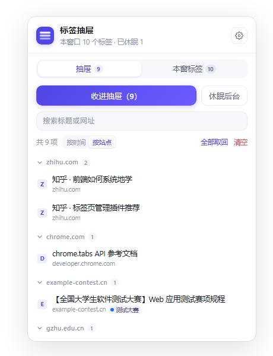
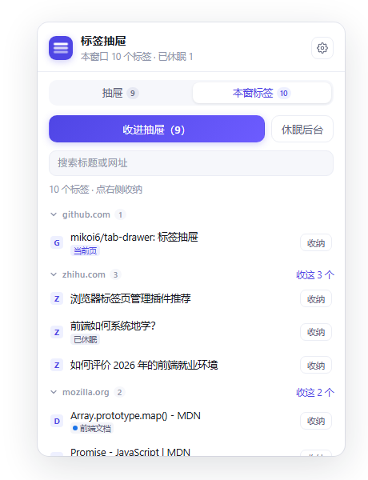

# TabDrawer · 标签抽屉

| 抽屉（按站点聚类） | 本窗标签（逐个收纳） |
| --- | --- |
|  |  |

一个 Manifest V3 浏览器扩展：把"暂时不看但绝对不能丢"的标签页收进抽屉，需要时再取回；
同时可选地自动**休眠**闲置的后台标签，把渲染进程的内存还回去。

> 想先看长什么样：直接双击 `preview.html`（用假数据的静态预览，不需要装扩展）。

---

## 一、它解决的两个不同问题

| 痛点 | 表现 | 对应能力 |
| --- | --- | --- |
| 视觉噪音 | 标签栏挤成一条缝，找不到正在用的那个 | **收纳**：一键把整窗标签变成一份列表，标签真的关掉 |
| 内存占用 | 30 个后台标签 ≈ 1~2 GB，风扇狂转 | **休眠**：标签留在栏上，渲染进程被回收，点一下重新加载 |

这两件事不要混着做。收纳是"我不想现在处理它"，休眠是"我马上还要用但你先别占着内存"。

## 二、安装（30 秒）

```bash
git clone git@github.com:mikoi6/tab-drawer.git
```

1. 打开 `chrome://extensions`（Edge 是 `edge://extensions`）。
2. 右上角打开「开发者模式」。
3. 点「加载已解压的扩展程序」，选择克隆下来的 `tab-drawer/` 目录。
4. 工具栏上会多一个紫色抽屉图标，点它打开面板。建议在拼图菜单里把它**固定**出来。

快捷键（可在 `chrome://extensions/shortcuts` 里改）：

- `Alt+Shift+A` 把**当前标签**收进抽屉（连按可逐个收）
- `Alt+Shift+S` 把当前窗口其他标签收进抽屉
- `Alt+Shift+D` 立即休眠所有后台标签

## 三、三种收纳粒度

同一个动作提供了三条入口，按"手上正好在做什么"选：

| 场景 | 入口 |
| --- | --- |
| 就想关掉眼前这一页 | `Alt+Shift+A`，或页面右键 → **把这个页面收进标签抽屉** |
| 想一个个挑着关 | 面板切到「本窗标签」，每行右侧的**收纳**按钮 |
| 同一个网站开了 8 个 | 「本窗标签」里站点组头的**收这 8 个** |
| 一次清空整个标签栏 | 面板顶部**收进抽屉（N）**，或 `Alt+Shift+S` |

> 在**标签栏**上右键（而不是页面里）看到"收进标签抽屉"，需要 Chrome 150+ 才支持
> `contexts:['tab']`。低版本上这个菜单项会被静默跳过，其余入口不受影响。

`Alt+Shift+A` 的妙处在于：关掉当前标签后浏览器会自动激活相邻标签，所以**连按就是逐个收**，
不需要额外做"拾取模式"。

## 四、按站点聚类与标签组

**按站点聚类**：抽屉列表可以在「按时间 / 按站点」之间切换，选择会被记住。本窗标签视图
则永远按站点分组，并把当前页所在站点排在最前。

站点键不是简单取最后两段——`jw.gzhu.edu.cn` 会被切成 `edu.cn` 就错了。`popup.js` 里用了
一份二级后缀小抄（`com.cn` / `edu.cn` / `co.uk` …），命中时多取一段。这**不是**完整的
Public Suffix List，但对个人项目够用；要零误判得引入完整 PSL 数据表。

**标签组**：收纳时如果页面在某个标签组里，会把组名和颜色一起存进抽屉（标题行上的小色点）。
取回时自动重建同名同色的组，多个原来同组的项会重新合成一个组。不想要可以在设置里关掉。

## 五、目录结构

```
tab-drawer/
├── manifest.json      # 扩展的"身份证"：权限、入口、快捷键都在这里
├── background.js      # Service Worker：所有写操作（收/取/删/休眠）+ 定时器
├── popup.html         # 面板骨架
├── popup.css          # 面板样式
├── popup.js           # 面板逻辑：api 层 / render 层 / handlers 层
├── icons/             # 图标（由 tools/make_icons.py 生成）
├── docs/              # README 用的界面截图（screenshot.png / screenshot-tabs.png）
├── tools/
│   ├── make_icons.py  # 纯标准库生成 PNG 图标
│   └── build_preview.py # 把三个文件合成 preview.html
└── preview.html       # 产物，用来在普通浏览器里预览界面
```

## 六、几个关键设计决定（这几条比代码本身值钱）

**1. 为什么写操作放在 Service Worker，不放 popup？**
popup 的本质是一个随时会被销毁的网页。鼠标移开、切个窗口，它立刻被回收，正在跑的
`await` 会被直接掐断。收 30 个标签是「读列表 → 存 storage → 关标签」三步，断在中间就会
得到"标签关了一半、抽屉里却没存"的状态。Service Worker 的生命周期由浏览器管理，能把
一整段异步跑完。所以 popup 只负责发消息，`background.js` 负责干活。

**2. 为什么不用 `chrome.tabs.query({currentWindow: true})`？**
Service Worker 里没有"当前窗口"，`currentWindow` 会退化成"最后获得焦点的窗口"，行为不
确定。所以显式取 `chrome.windows.getLastFocused({windowTypes:['normal']})` 的 id 再按
`windowId` 查。

**3. 休眠 vs 关闭，区别在哪？**
`chrome.tabs.discard()` 只释放渲染进程，`tab.discarded` 变 true，标签还在标签栏。
页面重新激活时会**重新加载**——所以未提交的表单内容会丢。这就是为什么默认"不打扰固定
标签""不打扰正在出声的标签"，以及为什么自动休眠默认是**关**的：这类功能最容易在你不知情
的时候弄丢东西。

**4. 去重策略**
同一个 URL 已经在抽屉里就不再存第二条，否则反复收纳会把抽屉灌成一堆重复项。

**5. 为什么 popup.js 里有一层 `api` 适配层？**
有扩展环境时走 `chrome.runtime.sendMessage`，没有时走内存假数据。好处有两个：一是这个
页面能脱离扩展单独预览/调样式，二是以后要把存储从 `chrome.storage` 换成 IndexedDB 或云端，
只改 `api` 一处。

**6. 标签组是"快照"，不是"引用"**
抽屉里存的是 `{title, color}` 这份快照，不是原 `groupId`。因为原组在你收纳完就消失了
（空组会被浏览器自动回收），groupId 没有跨会话的意义。取回时按"同名同色"重新成组，
所以同名不同色的两个组不会被合并。

**7. 单个收纳不新增 API**
`STASH_TABS` 一开始就接受数组，单个收纳只是传一个元素的数组。`Alt+Shift+A` 之所以能做到
"连按即逐个"，不是因为我们实现了拾取模式，而是因为**关掉当前标签后浏览器会自动激活相邻
标签**——把系统的默认行为用上，比自己造一套状态机稳得多。

**8. `[hidden]` 打不过 `display:flex`**
项目里多个容器是 `display:flex`，JS 里 `el.hidden = true` 会失效（UA 的 `[hidden]{display:none}`
优先级低于类选择器）。所以 CSS 顶部加了一条 `[hidden]{display:none !important}` 兜底。

## 七、数据结构

```js
// chrome.storage.local
{
  collection: [
    {
      id: "uuid",
      title: "页面标题",
      url: "https://...",
      favIconUrl: "https://...",
      savedAt: 1761...,
      group: { title: "测试大赛", color: "blue" } // 不在标签组里时为 null
    }
  ],
  settings: {
    autoSuspend: false,   // 是否自动休眠
    idleMinutes: 30,      // 闲置多久算闲置
    skipPinned: true,     // 不动固定标签
    skipAudible: true,    // 不动出声的标签
    rebuildGroups: true,  // 取回时重建标签组
    groupBy: "time"       // 面板列表默认分组：time | site
  }
}
```

权限申请了五个：`tabs`（读写标签、discard）、`storage`（存抽屉）、`alarms`（定时扫描）、
`tabGroups`（读组名/颜色、取回时建组）、`contextMenus`（右键菜单）。
**没有申请任何 host 权限**，也就是说这个扩展读不到任何网页内容。

## 八、可以继续做的方向

1. **云同步**：`chrome.storage.sync` 有 8 KB/项、100 KB 总量限制，抽屉很容易超；正解是
   自己搭个后端或者用 `storage.local` + 手写导出/导入 JSON。
2. **真正的内存数字**：`chrome.processes` API 能读到每个标签的内存占用，但需要在
   `chrome://flags` 打开实验特性，不能上架商店。商店版只能给"休眠了 N 个"这种计数。
3. **导入 OneTab/Toby 的导出文件**，抢第一批用户的迁移成本最低。
4. **AI 自动归堆**：把标题丢给模型分成 3~5 个主题，一天结束前给你一份"今天开了 47 个，
   建议留这 6 个"。
5. **完整 PSL**：把站点键的小抄换成 Public Suffix List 数据表，顺手解决 `github.io`
   这类公共后缀被当成站点的情况。

## 已完成

- [x] 按域名聚类（按时间 / 按站点切换，站点组可折叠）
- [x] 和标签组配合（收纳记组名与颜色，取回自动重建）
- [x] 单个 / 逐个标签收纳（行内按钮、右键菜单、`Alt+Shift+A` 连按）

## 九、调试备忘

- Service Worker 日志：`chrome://extensions` → 找到本扩展 → 点「Service Worker」。
- 改了 `background.js` 必须点扩展卡片上的刷新按钮，改 `popup.*` 只需重开面板。
- 面板里看不到 console？右键面板 → 检查。
- 想直接进某个视图调样式：`preview.html#tabs`、`preview.html#site`。
- 图标重生成：`python tools/make_icons.py`
- 预览页重生成：`python tools/build_preview.py`

---

[MIT License](LICENSE) © 2026 mikoi6
